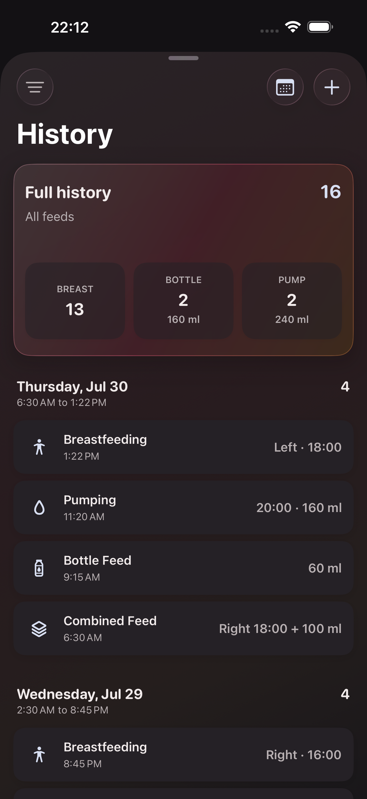
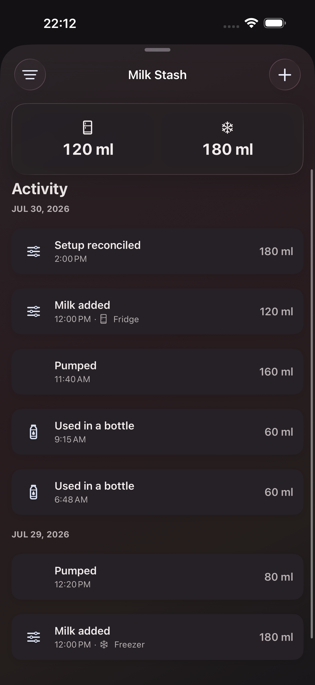

# One history when feeding does not fit one category

Feeding can change from one day to the next. A breastfeed may be followed by a bottle top-up. Someone else may give expressed milk while you rest. Pumping may become part of the routine for a while, then become less important later.

Breastfeeding Tracker & Timer keeps those records together without turning them into a complete baby-care dashboard. You can record a Breastfeeding Session, Bottle Feed, Pumping Session or Combined Feed, then see each activity in the same chronological history.

# Record the kind of feed that happened

For a breastfeed, start with the left or right side and let the timer run. If the feed began before you remembered, move the recorded start time back. You can switch sides during a session while keeping it as one breastfeeding record.

For a bottle, record expressed milk, formula or a mixed bottle. Add the amount when you know it, or leave it blank when you do not. The tracker is there to remember what you entered, not to judge the amount or tell you what your baby needs.

For pumping, start a timer or add a completed session later. You can record the amount expressed when that is useful, without making a measured volume compulsory.

# Keep a breastfeed and bottle top-up together

A Combined Feed is one breastfeeding component followed by one bottle top-up. It appears as a single activity in the timeline rather than two unrelated feeds, while still contributing to the breastfeeding and bottle totals in your recorded summaries.

That makes it useful when “breast” or “bottle” alone would leave out an important part of what happened. It does not prescribe an order, schedule or feeding method. It simply gives one real feeding moment one clear place in the history.

# See the expressed milk you recorded

When a pumping session includes an amount, that milk goes into your Milk Stash as a portion in the fridge, or the freezer if you choose. Each portion keeps its own amount, the time it was expressed, where it is stored and an optional label, so you can move it to the freezer, start thawing it or use it later.

When a bottle is marked as expressed milk, its amount comes out of the portions you have stored. Formula does not use your stash, and a mixed bottle uses only the expressed-milk amount you enter. If a bottle uses more expressed milk than you have stored, the feed is still saved in full and the stash never goes below zero.

The Milk Stash shows what is in the fridge and freezer, with a log of milk pumped, added and used. Portions that need attention are marked so they are easy to find. Correcting or deleting a pumping session or bottle updates the stash for you, so you do not need to keep a second total by hand.

# Use Apple Watch for the timers that suit your wrist

On Apple Watch, you can start and stop breastfeeding and pumping timers without reaching for your iPhone. If the watch is temporarily offline, completed sessions sync after the devices reconnect.

Use the iPhone app to record bottles and Combined Feeds, review the complete history, correct details and manage your Milk Stash. [Read the Apple Watch guide](/breastfeeding-tracker/support/breastfeeding-tracker-apple-watch/) for the wrist-based workflow.

# Correct the record when the moment is calmer

A useful feeding history does not have to be perfect at 3am. Add a completed activity after it happened, move a late timer back, or edit and delete an entry later. Changes to records also flow through to the summaries and Milk Stash that depend on them.

If you need a portable copy, select the history you want and export it as a PDF. The export contains only what you recorded. It is not a clinical report and the app does not assess milk transfer, feeding adequacy or your baby’s health.

[Learn how to correct missed feeding logs](/breastfeeding-tracker/support/edit-missed-feeding-logs/) or [create a PDF from selected history](/breastfeeding-tracker/support/export-breastfeeding-log-pdf/).

# FAQs

## Can I track breastfeeding and bottle feeding in the same app?

Yes. Breastfeeding Sessions, Bottle Feeds, Pumping Sessions and Combined Feeds all appear in the same chronological history, so you do not need a separate log for each feeding method.

## What is a Combined Feed?

A Combined Feed is one breastfeeding component plus one bottle top-up, stored as one timeline activity. It contributes to both the breastfeeding and bottle totals in the summaries created from your records.

## Can I track pumping as well as breastfeeding?

Yes. Start a pumping timer on iPhone or Apple Watch, or add a completed pumping session later. If you record an expressed amount, it is added to your Milk Stash.

## Does the app track a milk stash or individual storage bags?

Yes. The Milk Stash keeps each pumped amount as its own portion in the fridge or freezer, with its expression time and an optional label. Bottles of expressed milk use milk from those portions, and portions that need attention are marked.

## Can I fix a bottle or pumping entry later?

Yes. You can add, edit and delete completed records. Corrections also update dependent summaries and your Milk Stash.

## Does the tracker tell me how much or how often my baby should feed?

No. It records the details you enter and provides informational summaries only. It does not assess feeding, milk supply or health, and it is not a substitute for support from a qualified healthcare professional.
